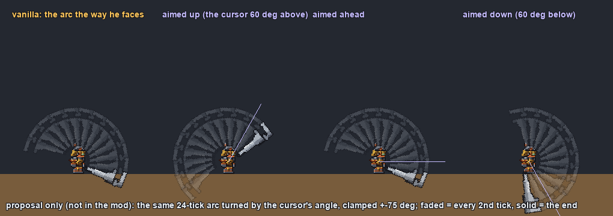

# Melee mechanics study: directional swings and better hit feel (2026-11-05)

The user's request (2026-11-05, item 8): "decompile and study a way to implement better melee mechanics like directional
melee attack for melee weapons (it should affect default terraria and our mod weapons), and better effects and
animations, some mods already does this but i want our mod to have natively (research logic and verify applicability
first)."

> **Status (0.2.3, 2026-11-26):** directional swings are now a rule for Cogpunk's own melee weapons (user: "our melee weapons
> for the mod must have directional swings that actualy track cursor position"), built as §3.2-3.4 propose in
> `Core/Combat/DirectionalSwing.cs` (the aim, its packet, the pose, the swept hits) for the Cogspring Sword, the Macuahuitl, the
> Jade Phaseblade and Phasesaber and the Firesaw. Two differences from the proposal: the aim follows the cursor through the swing
> (eased), not only at its first tick, and a cursor behind the player counts by its height. Vanilla's own weapons are still
> untouched (phase A of §6 is not done).

This page is the research and the applicability check, not an implementation: nothing below is in the mod yet except
`Core/Combat/SwingPose.cs` and the Metal Wrench's slam, which were built for the same request's item 7 and are the working
proof of the core technique. Every vanilla fact was read from tModLoader v2026.08.3.0 decompiled with `ilspycmd`
(`C:\tML\_reference\decomp\`), with the method named so it can be re-checked.

## 0. Verdict

**Applicable, natively, with public hooks only.** Every piece a directional melee system needs is a tModLoader 1.4.4
hook (`GlobalItem`, `GlobalProjectile`, `ModPlayer`, `PlayerDrawLayer`) or a public vanilla `Player` method. It needs no
IL edits, detours or reflection (D0 rule 14, SKILL §3.8), so a vanilla or tModLoader update cannot crash it.

- **Already working (compiled, in this change):** a custom swing curve on a real weapon. The Metal Wrench poses its arm
  and item every tick, hits along the drawn blade and sweeps between ticks. It uses `UseStyle`, `SwingPose`,
  `UseItemHitbox` and `CanMeleeAttackCollideWithNPC`, and compiles with 0 errors and 0 warnings against v2026.08.3.0.
- **Not yet verified:** applying it to every vanilla blade through a `GlobalItem` (the same hooks exist on `GlobalItem`,
  checked in `ItemLoader`), the in-game feel, and multiplayer, where the aim needs one small packet per swing.

Recommended next step: phase A of §6, with the switch defaulting to on. It is a server-side config option, so a server
can turn it off.



## 1. How vanilla melee works

### 1.1 The order of one tick of a swing (`Player.ItemCheck_Inner`)

1. The composite arms are reset: `compositeFrontArm.enabled = false; compositeBackArm.enabled = false;`, just before the
   use style runs.
2. `ItemCheck_ApplyUseStyle(mountOffset, item, drawHitbox)` runs vanilla's style (`ItemCheck_ApplyUseStyle_Inner`), then
   `ItemLoader.UseStyle(sItem, this, heldItemFrame)`. A mod's `UseStyle` runs after vanilla's and has the last word on
   `itemLocation`, `itemRotation` and the arms.
3. If the item hits (`!noMelee`, damage), `ItemCheck_GetMeleeHitbox` builds the hit rectangle:
   - The base rectangle is the held frame's size times the item's scale (32x32 on a dedicated server, which has no
     textures).
   - It is stretched by the third of the swing it is in.
   - Then `ItemLoader.UseItemHitbox(sItem, this, ref itemRectangle, ref dontAttack)` runs.
4. `ItemCheck_EmitUseVisuals` (the `MeleeEffects` hook), then `ItemCheck_CutTiles` (grass, pots, webs) with the
   rectangle.
5. `ItemCheck_MeleeHitNPCs` calls `ProcessHitAgainstNPC` for every NPC with `immune[whoAmI] == 0`:
   - The rectangle-versus-hitbox intersection decides the hit.
   - `CombinedHooks.CanPlayerMeleeAttackCollideWithNPC(...)` can then force it (`true`) or veto it (`false`).
   - A line-of-sight check (`CanHit`) comes last.
   - A landed hit sets `SetMeleeHitCooldown(npc, itemAnimation)`: one hit per enemy per swing.
6. `ItemCheck_MeleeHitPVP` uses the rectangle and `ItemLoader.CanHitPvp`.

### 1.2 The swing itself (`ItemCheck_ApplyUseStyle_Inner`, useStyle 1)

```csharp
if (Main.dedServ) return;                       // the server never poses a swing
...
itemRotation = ((float)itemAnimation / (float)itemAnimationMax - 0.5f) * (float)(-direction) * 3.5f - (float)direction * 0.3f;
if (gravDir == -1f) { itemRotation = 0f - itemRotation; itemLocation.Y = position.Y + height + (position.Y - itemLocation.Y); }
```

- `itemLocation` jumps between three fixed spots (one per third of the swing), sized by the frame's width.
- The rotation runs linearly over the whole use. Facing right, the blade (`itemRotation - 45°`, since swing sprites point
  to their top right) goes from **-162°** (up, behind the head) to **+38°** (ahead, below horizontal). It crosses straight
  ahead at 81% of the use.
- The arm is not posed: `PlayerFrame` picks one of three body frames by the third of the swing (`bodyFrame.Y` =
  1/2/3 × height), then calls `ItemLoader.UseItemFrame`.

### 1.3 How the item is drawn (`PlayerDrawLayers.DrawPlayer_27_HeldItem`)

- A swing sprite is drawn at `ItemLocation` turned by `itemRotation` about its bottom corner: origin
  `(W/2 - W/2 * direction, H)`, mirrored facing left.
- It is drawn at the player's adjusted item scale.
- `noUseGraphic` skips the drawing entirely, which is how spears, yo-yos and the Zenith hide the item.

### 1.4 The arms

- `SetCompositeArmFront(enabled, stretch, rotation)` turns the front arm. A rotation `r` points it along `r + 90°`, and it
  mirrors itself under reversed gravity.
- `GetFrontHandPosition(stretch, rotation)` is the hand: the mounted centre, plus the arm's length (10 px fully
  stretched), plus the shoulder's offset (`(-4, -2)` facing right) and a 3 px turn across it.
- Vanilla's own useStyle 9 poses with exactly these two calls, inside the use style.

### 1.5 Which way a swing goes

- A swing goes the way the player faces (`direction`).
- Vanilla turns the player toward the cursor only when an item shoots (`ItemCheck_Shoot`: `ChangePlayerDirectionOnShoot`,
  then `ChangeDir` by the dot product with the cursor).
- `ItemCheck_StartActualUse` turns only for `useTurnOnAnimationStart` items and while grappling. A plain blade swings
  whichever way the player last moved.

### 1.6 Netcode

- Melee hits are decided on the owner's client: `ProcessHitAgainstNPC` runs there and sends message 28, `DamageNPC`.
- Other clients replay the swing from the synced controls (message 13) and recompute the pose from `itemAnimation`.
- Message 41 (`ItemAnimation`) carries `itemRotation` only. Vanilla sends it when an aimed style (5 or 13) shoots, and
  the receiver's own use style overwrites it the next tick.
- **An aimed swing therefore needs its own sync**: the aim, once per swing.

### 1.7 The 1.4.4 sword auras

- Night's Edge, Excalibur, True Excalibur, True Night's Edge and The Horseman's Blade are `noMelee`. The Terra Blade has
  its own branch. The item itself never hits: it shoots an aura slash (`AI_190_NightsEdge`, aiStyle 190: projectiles 972
  Night's Edge, 982 Excalibur, 983 True Excalibur, 984 Terra Blade and 997 The Horseman's Blade).
- `ItemCheck_Shoot` spawns the aura with velocity `new Vector2(direction, 0)`, `ai[0] = direction * gravDir` and
  `ai[1] = itemAnimationMax`.
- The aura's rotation every tick is `π * ai[0] * progress + velocity.ToRotation() + ai[0] * π + player.fullRotation`.
- **So an aura is aimed by turning its velocity once, at spawn.** `ProjectileLoader.OnSpawn` runs inside
  `Projectile.NewProjectile` before the owner sends message 27, so a turn made in `GlobalProjectile.OnSpawn` reaches
  every client.

### 1.8 Vanilla's helpers, and their traps

- `Player.GetPointOnSwungItemPath`: a point along the swung item (only the Volcano uses it, for its own line test).
- `Collision.CheckAABBvLineCollision(pos, size, a, b, width, ref point)` is a thick-line test, but it **allocates a
  `Vector2[4]` every call** (D1).
- `Utils.LineRectangleDistance` only measures the box's corners, so **a blade through the middle of a big hitbox misses**.
- `SwingPose.CapsuleHitsRect` (this change) is exact and allocation-free. A segment that misses a box is nearest to it at
  an endpoint of one of them, so it checks the ends, the corners and the four edges.

### 1.9 How many vanilla items it would touch

A regex pass over the decompiled `Item` SetDefaults switch (approximate) found **about 139** useStyle-1 melee items with
damage:

| kind | count | notes |
|---|---|---|
| plain swung blades | ~64 | drawn, hit with the item: the main target |
| tools | 47 | pickaxes, axes, hammers |
| `noMelee` | 28 | the five aura swords, boomerangs, flails... |
| `noUseGraphic` | 22 | the item isn't drawn: excluded |

## 2. What other mods do (feature level; no code taken)

- **Terraria Overhaul.**
  - Its pages describe broadsword power attacks (about 1.6× for a well-timed swing), axes pushing the player toward the
    cursor, headshots (+5%) and killing blows. They don't say how its swings are aimed.
  - Its code is GPL-3.0 (its GitHub README), so none of it can be copied into Cogpunk.
- **Revision: Combat:** "melee weapons now can aim in any direction".
- **Overhaul Item Animations:** "head rotating and body facing to cursor".
- **Pitfalls players report with swing mods:**
  - Swings going opposite to the cursor.
  - Hitboxes that don't match the drawn swing.
  - In multiplayer, the second player's slashes not following their own cursor, which is the missing aim sync.

  §3 answers each one.

## 3. Design for Cogpunk (a proposal)

### 3.1 What it applies to

- **Included:** vanilla items and Cogpunk's own items with useStyle 1, damage > 0, drawn (`!noUseGraphic`), not channelled.
- **The five aura swords:** through their aura (§3.5).
- **Excluded:**
  - Tools, by default.
  - `noMelee` items that aren't auras (boomerangs, flails: their projectiles are already aimed).
  - Cogpunk weapons with their own swing (the Metal Wrench's slam).
  - Anything in a new `CogpunkSets.NoDirectionalMelee`.
  - Other mods' items. Their swings are their authors' design, and their custom swings mostly use held projectiles.
- **Turned off** when Terraria Overhaul is loaded (`ModLoader.HasMod`), so two systems never turn the same swing.

### 3.2 The aim

- **Taking it:** on the owner, at the swing's first tick, the angle from `MountedCenter` to `Main.MouseWorld` (the aim
  stick on a gamepad).
- **Facing:** the player turns toward the cursor, as vanilla already does for shooting items.
- **Clamp:** the angle becomes an offset in the facing frame, held to ±75°.
- **Sync:**
  - A `CogpunkPacket` carries the player byte and the offset in 1.4° steps (an sbyte). It is sent once per swing, only
    when it changes, and the server relays it (`ignoreClient: sender`).
  - Remote clients ease to it over two ticks, so a late packet never snaps the pose.
  - Until a packet arrives, a remote swing uses offset 0 (vanilla).

### 3.3 The pose

- Vanilla's own arc (§1.2) turned by the offset, so a straight-ahead swing looks exactly like vanilla's.
- `SwingPose.Apply`: the front arm along the blade, the hand as `itemLocation`, `itemRotation` set for vanilla's drawing.
- Mirrored under reversed gravity as vanilla does.
- The same helper the wrench uses.

### 3.4 The hits

- **NPCs:**
  - `UseItemHitbox` makes the blade's bounding box (vanilla still cuts grass and pots with it).
  - `CanMeleeAttackCollideWithNPC` returns the capsule test along the sprite's diagonal, swept over the last tick. A
    fast blade turns 25-35° a tick.
  - The capsule's length comes from the frame's size times the item scale; its radius is about a fifth of the diagonal,
    or measured per item where the art is odd.
- **PvP:** `CanHitPvp` with the same test.
- **Knockback:** the side follows the swing, as vanilla's `direction` does. An upward swing could add a small upward push
  in `OnHitNPC` (a design call).

### 3.5 The aura swords

- A `GlobalProjectile` for the AI-190 family.
- In `OnSpawn`, when the source is its owner's item use and the swing is aimed, it turns `velocity` by the offset
  (mirrored facing left).
- The slash's drawing and its hit area both come from that velocity (§1.7), so they follow the aim.

### 3.6 Better hit feel

| effect | how | cost / risk |
|---|---|---|
| Smears | The item sprite drawn again at the last 2-3 ticks' poses, fainter each, from a `PlayerDrawLayer` before the held item. Built for the wrench; works for any sprite and needs no state. | none; client-only |
| Visual hit-stop | On a hit, the drawn pose holds for 2-4 ticks while the swing's timers run on: the impact reads, DPS is unchanged (a real freeze of `itemAnimation` would cut DPS). | low |
| Impact sparks | At the capsule's contact point (the closest point on the blade), coloured by the target (metal, flesh, slime). | dust caps (SafeSpawn) |
| Camera punch | Scaled by the weapon's weight class, owner only, behind the Screen Shake option (already used by bosses). | none |
| Weightier sounds | Pitch variance per swing, a heavier impact sound on hit. | none |
| Power attacks | Hold to charge a stronger swing (Overhaul's idea, done our way). | a balance change: a separate option |

### 3.7 Options

- **Directional Melee:** a server-side option (it changes hit areas, so everyone in a world shares it). Default on, but
  off when Overhaul is present.
- **Melee Effects:** client-side (smears, hit-stop, punch), joining the existing Screen Shake and Effect Density options.

### 3.8 Where it goes

| file | role |
|---|---|
| `Core/Combat/SwingPose.cs` | exists (pose, blade points, capsule test, easing) |
| `Core/Combat/DirectionalMelee.cs` | the `GlobalItem` (pose, hitbox, collision, PvP) |
| `Core/Combat/DirectionalMeleePlayer.cs` | the aim (taken, eased, sent) |
| `Core/Combat/AimPacket.cs` | the aim's packet |
| `Core/Combat/AuraAim.cs` | the `GlobalProjectile` for the auras |
| `Core/Combat/MeleeTrailLayer.cs` | smears for every aimed swing |
| `Core/Combat/MeleeImpact.cs` | the hit feel |
| `CogpunkSets.NoDirectionalMelee` | the opt-out set |
| config entries | the two options of §3.7 |

## 4. Applicability check

| need | how | verified by | status |
|---|---|---|---|
| Pose any swing | `GlobalItem.UseStyle` after vanilla's | `Player.ItemCheck_ApplyUseStyle` | ✔ decompiled |
| The arm follows | `SetCompositeArmFront` (+ hand) | reset in `ItemCheck_Inner` before the style; vanilla's useStyle 9 | ✔ decompiled; used by the wrench |
| The drawing follows | `itemLocation` / `itemRotation` | `DrawPlayer_27_HeldItem` origin | ✔ decompiled; used by the wrench |
| Exact hits | `CanMeleeAttackCollideWithNPC` | `ProcessHitAgainstNPC` | ✔ decompiled; used by the wrench |
| Tile cutting | `UseItemHitbox` | `ItemCheck_GetMeleeHitbox` | ✔ |
| PvP | `CanHitPvp` | `ItemCheck_MeleeHitPVP` | ✔ hook exists |
| Aura swords | turn the velocity in `OnSpawn` | `AI_190_NightsEdge`; `NewProjectile` calls `OnSpawn` before message 27 | ✔ decompiled |
| Sync | own packet | message 41 is overwritten each tick (§1.6) | ✔ (needs the packet) |
| Dedicated server | nothing to do but relay | `ApplyUseStyle_Inner` returns on `dedServ`; hits are the owner's | ✔ |
| The whole technique compiles | the wrench's slam | `dotnet msbuild -t:Compile`, 0 errors, 0 warnings | ✔ |
| In-game feel, multiplayer | — | — | ✘ needs a playtest |

## 5. Risks

- **D0 (crashes):**
  - Hooks only.
  - Guarded math (non-finite angles ignored, clamped `asin`).
  - The packet validates its player index.
  - The Volcano's own line test (`type == 121`) is overridden by our collision answer. Its explosion still follows
    vanilla's path, so exclude it or accept the small mismatch.
- **D1 (performance):**
  - The capsule test runs only for NPCs the hook is asked about (vanilla's loop), after a bounds check.
  - One packet per swing; no allocation.
- **D2 (co-op):** the aim packet, remote easing, the server-side option for PvP fairness.
- **D3 (balance):**
  - Aimed swings reach above and below. Flying enemies get easier and the hit behind the head is lost.
  - Bosses tuned against vanilla swords may need a check.
  - Measure TTK in the `CogBal-*` worlds before turning it on by default.
- **Compatibility:**
  - Only vanilla and Cogpunk items.
  - Overhaul detected.
  - Another mod's `GlobalItem.UseStyle` on vanilla swords would fight ours; it runs in load order, so put it in the
    Known issues.

## 6. Plan

| phase | contents | proof |
|---|---|---|
| A | Aimed swings for vanilla and Cogpunk blades: the aim and its packet, the pose, the capsule hits, the aura swords, the two options, Overhaul detection | a sim GIF per case (up, ahead, down, an aura, a remote player's replay) and a two-client test |
| B | Hit feel for every melee swing: smears, visual hit-stop, impact sparks, camera punch, sounds | GIF |
| C (optional) | Power attacks, an upward launch, tools aimed | balance rows |

**Decisions for the user:**

- Default on or off.
- The ±75° clamp.
- Tools included or not.
- Whether a down-aimed swing stops at the foot line like the wrench, or passes through the ground like vanilla's.
- Whether power attacks are wanted at all.
